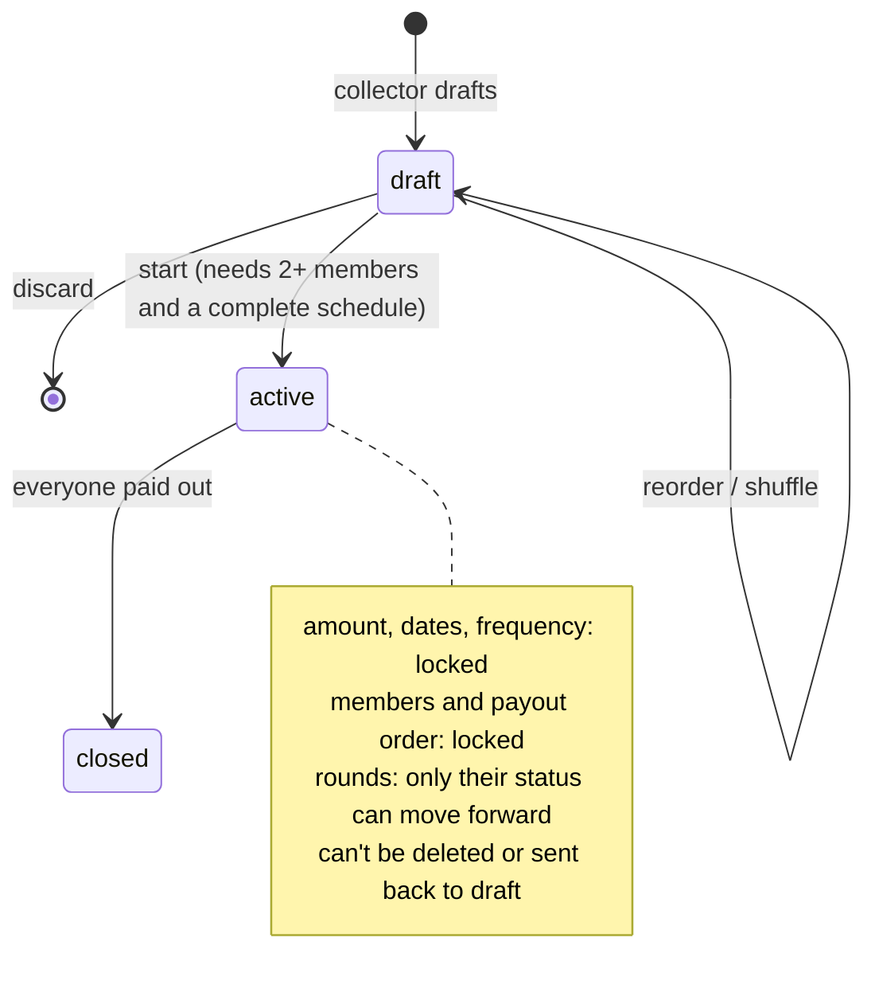
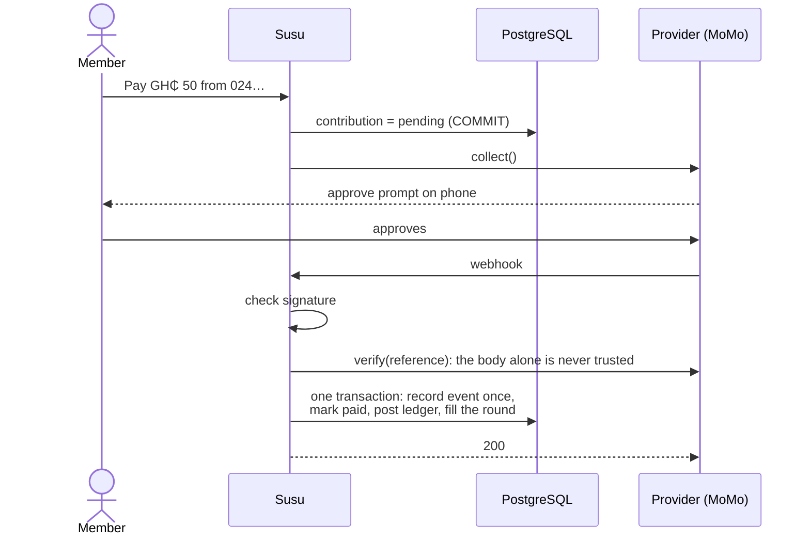

# Susu

[](https://github.com/WaifaiMT/susu/actions/workflows/ci.yml)

An open-source app for running **susu groups**: the rotating savings groups used across Ghana and West Africa. Everyone pays the same amount each round, one member takes the whole pot, and the order rotates until everyone has been paid once.

Built with **Next.js 16, TypeScript, and PostgreSQL**. Being built in public: see the [roadmap](#roadmap).

> ⚠️ **A demo and learning project, not a live money service.** It runs on test and sandbox payment keys only. Collecting and holding other people's savings for real needs a licence from the Bank of Ghana.

## What a susu is

Five traders agree to pay GH₵ 50 every week. Each week one of them receives GH₵ 250. After five weeks, everyone has paid in GH₵ 250 and received GH₵ 250. That's one **cycle**. Nobody earns interest; the value is getting a lump sum early, and the discipline of saving with people you know.

It runs on trust, so arguments start when the rules move: "the amount was GH₵ 40 when I joined", "it was supposed to be my turn". This app's main job is to make the rules **impossible to change once a cycle starts**.

## What works today

| | |
|---|---|
| **Groups** | Each susu group is a tenant with its **own PostgreSQL schema**, so one group's data can't reach another's |
| **Roles** | **Collector** runs the group and sets the rules · **Treasurer** helps (invites, audit log) but can't change the rules · **Member** pays in and gets paid out |
| **Cycles** | Draft a cycle: contribution amount, daily/weekly/monthly, first due date, and a payout order (random draw or join order), then rearrange it by hand |
| **Locked schedule** | Starting a cycle generates every round's date and recipient. From then on the amount, dates and order are **locked by the database itself** |
| **Money** | Every amount is an integer number of **pesewas**, never a float |
| **Mobile Money contributions** | Members pay their round with MoMo through [pesewa](https://github.com/WaifaiMT/pesewa): a prompt on their phone, or an OTP step, then a verified webhook. A built-in **test provider** runs everything with no keys; Paystack test mode and the MTN MoMo sandbox work too. Live keys are refused |
| **Cash** | Collectors and treasurers record cash contributions, which count towards the round like MoMo ones |
| **Double-entry ledger** | Every cedi in is two entries that sum to zero, checked by the database at commit. Append-only: mistakes are corrected with new entries, never edits |
| **Paid twice, or the wrong amount** | The money is booked as **owed back**, not lost and not counted towards the round |
| **Audit log** | Every draft, reorder, start, payment and cash entry is recorded in the same transaction as the change |
| **Invites** | Single-use, expiring links tied to an email, stored hashed |

## How the rules are enforced

The app checks the rules and shows friendly errors. But a check in application code only protects you from the paths you remembered. So the same rules are also **triggers and constraints in PostgreSQL** ([`0001_cycles.sql`](src/db/migrations/tenant/0001_cycles.sql)), and they hold even for a raw `UPDATE` typed into `psql`:



| Rule | Enforced by |
|---|---|
| One open cycle per group, even if two requests race | Partial unique index on `cycles` |
| Started cycle's amount, dates, frequency can't change | `cycles_guard` trigger |
| Started cycle's members and order can't change | `cycle_members_guard` trigger |
| Rounds can't be moved, reassigned, added, or deleted; a paid-out round never reopens | `rounds_guard` trigger |
| A cycle can only start with a complete schedule | `cycles_guard` checks members = rounds = positions 1..n |
| Nobody gets two payouts in one cycle | `UNIQUE (cycle_id, recipient_user_id)` on `rounds` |
| Two members can swap places | Deferred unique constraint on payout positions |

The [tests](tests/cycles.test.ts) try to break each rule with raw SQL and assert that Postgres refuses.

## How money moves

A contribution is saved and **committed before the provider is called**, so a webhook that beats the provider's own reply always finds it. The outcome only counts once it's confirmed with the provider's API:



The ledger, in pesewas (debits positive, credits negative):

| Event | Entries |
|---|---|
| GH₵ 50 by MoMo for round 3 | `clearing:<provider>` +5000 · `round:3` −5000 |
| GH₵ 50 in cash for round 3 | `cash` +5000 · `round:3` −5000 |
| Paid twice, or GH₵ 40 instead of 50 | `clearing:<provider>` +amount · `refunds_due` −amount |

**Nothing is counted twice.** A duplicate webhook hits `UNIQUE (provider, event_key)` and is ignored; the contribution row is locked and its status checked; and the ledger allows one posting per source (`UNIQUE (kind, source_id)`). The round row is locked while payments are counted, so when the last two members pay at the same moment, the round is still marked full. Two tabs can't send two prompts: only one attempt per member can be waiting (a partial unique index).

[`tests/contributions.test.ts`](tests/contributions.test.ts) covers each of these, and [`tests/ledger.test.ts`](tests/ledger.test.ts) runs random mixes of payments, declines, duplicate webhooks, wrong amounts and cash, checking after every step that the books balance and match the contributions.

## Roadmap

- [x] **Week 1:** groups, roles, drafting and starting cycles, the locked schedule
- [x] **Week 2:** contributions with Mobile Money ([pesewa](https://github.com/WaifaiMT/pesewa): test provider, Paystack test mode, MTN MoMo sandbox), cash, verified webhooks, a **double-entry ledger**
- [ ] **Week 3:** payouts that can't happen twice, failed and reversed transfers, daily **reconciliation** against the provider
- [ ] **Week 4:** demo data, screenshots, and a wiki: architecture, how money moves, idempotency, threat model, what broke

Work is tracked in [issues](https://github.com/WaifaiMT/susu/issues).

## Run it locally

You need Node.js 20.9+ and PostgreSQL 14+ (local, or `docker compose up -d`).

```bash
cp .env.example .env      # point DATABASE_URL at your database
npm install
npm run db:migrate
npm run db:seed           # two demo groups: one running, one being drafted
npm run dev
```

Sign in as `ama@example.com` (collector of the running group) or `kofi@example.com` (collector of the draft, treasurer of the running one), password `password1234`. `akosua@example.com` hasn't paid yet.

### Payments in development

By default Susu uses its **built-in test provider** (`PAYMENTS_PROVIDER=fake`): no keys, nothing charged. After you pay, the page shows **Simulate: approve on phone** and **Simulate: decline**, which send a signed webhook through the same code path a real provider's would. Test numbers: ending `0000` is declined, ending `1111` asks for an OTP (`123456`).

To try a real provider's test environment, set `PAYMENTS_PROVIDER=paystack` with a `sk_test_` key, or `mtn_momo` with sandbox keys (see `.env.example`). Webhooks go to `/api/webhooks/<provider>`; on a laptop, a [Cloudflare quick tunnel](https://developers.cloudflare.com/cloudflare-one/connections/connect-networks/do-more-with-tunnels/trycloudflare/) gives you a public URL for the provider's dashboard.

```bash
npm test          # integration tests against a throwaway PostgreSQL database
npm run lint
npm run typecheck
```

## How it's built

```
public schema (shared)                 org_<id> schema (one per group)
├── users, sessions                    ├── cycles          amount, frequency, start, status
├── organizations (groups)             ├── cycle_members   who's in, payout position
├── memberships (role)                 ├── rounds          due date, recipient, status
├── invites                            ├── contributions   every payment attempt
├── audit_log                          ├── ledger_accounts, ledger_transactions, ledger_entries
├── payment_references (→ group)       └── _migrations
└── webhook_events (each once)
```

- Every group query runs through `withTenant()`, which opens a transaction and sets `search_path` to that group's schema with `SET LOCAL`, so a pooled connection never carries one group into the next request.
- `src/lib/services/` holds the business logic; pages and server actions only call it. Every service takes an `OrgContext` (who, which group, which role) and checks permissions from one map in `src/lib/permissions.ts`.
- Dates are calendar dates. Ghana is on GMT all year, so UTC is the group's local time. Monthly rounds keep their day and fall back to the month's last day (31 Jan → 28 Feb → 31 Mar).

Based on my [saas-starter](https://github.com/WaifaiMT/saas-starter) (schema-per-tenant, auth, roles, invites, audit log).

## License

[MIT](LICENSE) © Gilbert Addai Gyan
